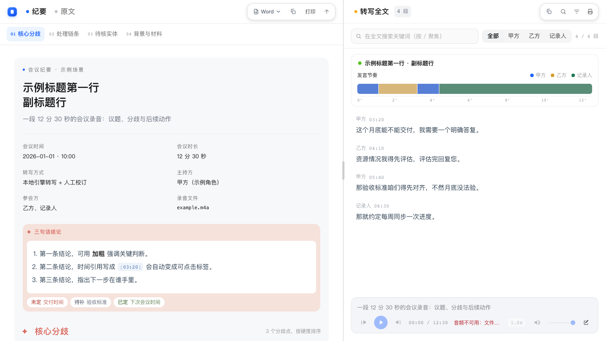

# 录音转写 · Audio Transcript Skill

> 本仓库提供 DSH 插件版和 WorkBuddy 技能包。DSH 插件注册技能名 `audio-transcript`；WorkBuddy 版使用 `@skill:"录音转写"`。两者共用转写与渲染脚本。

把一段录音变成**能点着回听的交互纪要**，而不是一段躺在 txt 里的流水文字。

输入 `m4a` / `mp3` / `wav`，输出：

- 带时间戳的对话稿（可选说话人分离）
- 一个**双栏阅读器**：左栏结构化纪要，右栏全文；点任意时间码跳到对应音频位置
- 六套皮肤可换，深浅都有
- 页内可全文搜索、按说话人筛选、导出 Word、复制文字

纯本地转写（Apple Silicon 上 `mlx-whisper` 约 4 倍实时），不需要联网、不需要上传音频。



## 为什么不是「转写完就完了」

转写只解决「听不清」，真正花时间的是**把录音变成能被别人读的东西**。这个包把后半段做完了：

| 环节 | 通常做法 | 这里 |
|---|---|---|
| 定位一句话 | 拖进度条猜位置 | 点时间码直接跳到那一秒 |
| 找某个话题 | Ctrl+F 翻全文 | 左栏目录 + 全文搜索双向高亮 |
| 给同事看 | 截图 + 手打要点 | 导出 Word，纪要 + 全文两档可选 |
| 长录音回听 | 从头听 | 节奏条显示哪里话密，可按说话人筛选 |
| 现场确认 | 会后整理 | `record.py` 边录边转，实时字幕 |

## 在 DSH 中使用

通过 DSH 插件管理器安装本仓库的插件 bundle。启用后技能名为 `audio-transcript`；技能资源随插件提供，无需手动复制到 skills 目录。详见 [DSH 版说明](README-DSH.md)。

转写链路依赖按 `requirements.txt` 自备，首次使用模型可能需要下载；渲染器使用 Python 标准库。插件包包含 MIT 许可证。

不用 DSH 也没关系，下面的命令行流程用的是同一套脚本。

## 在 WorkBuddy 中使用

1. 从 [Releases](https://github.com/chengfeiai/audio-transcript-skill/releases) 下载 **WorkBuddy 版**压缩包，解压出 `录音转写/` 文件夹。
2. 把整个文件夹放进当前 profile 的 `skills` 目录，重新加载技能后即可调用。
3. 转写链路依赖按 `requirements.txt` 自备；渲染器只用系统 `python3`，无需额外安装。
4. 压缩包内不含 `LICENSE`，授权见仓库根目录 `LICENSE`（MIT），转发时请一并附上。

不用 WorkBuddy 也没关系，下面的命令行流程用的是同一套脚本。

## 快速开始

```bash
# 1. 转写（需要装有 mlx-whisper 的 Python 3.11，下文记作 <PY>）
<PY> scripts/transcribe.py 录音.m4a --model medium --lang zh --srt --md

# 2. 分离说话人（可选）
<PY> scripts/diarize.py 录音.m4a --min-speakers 1 --max-speakers 4

# 3. 人工校订，存成 <名>.整理稿.txt，每行 [mm:ss] 说话人：正文

# 4. 渲染双栏纪要（系统 python3 即可，纯标准库）
python3 scripts/render_split.py \
  --content 渲染输入/内容.json \
  --transcript "整理稿.txt" \
  --audio 录音.m4a \
  --skin mist --check --out "纪要.html"
```

`--check` 会打印「段落 N 段 · 引用 M 处 · 断链 K 处」，**断链必须为 0** —— 它检查每个可点时间码是否真的对得上一段转写。

## 六套皮肤

按各自实际视觉命名，不含任何第三方品牌名：

| id | 名称 | 视觉 |
|---|---|---|
| `mist` | 灰蓝粉彩 | 灰蓝画布 + 粉彩分节 + 白芯卡片（默认） |
| `obsidian` | 黑曜潮青 | 近黑底 + 骨白正文 + 薄荷强调 |
| `plain` | 素白极简 | 纯白无卡 + 发丝线分栏 + 渐变标题 |
| `dark` | 深蓝学术 | 深藏青 + 蓝图网格 + 宋体标题 |
| `neutral` | 中性灰阶 | 中性灰 + 1px 描边 + 唯一强调色 |
| `default` | 模板原生 | 无皮肤，模板自带样式 |

三套深色的对比：`obsidian` 是黑底薄荷色，`dark` 是深蓝藏青。

## 界面约定

- **双栏独立滚动**：滚左栏不动右栏，反之亦然；不整页滚动。
- **分栏可拖动**：中间分隔线拖动调宽度（26%–78%），双击复位；3px 阈值防误触。
- **播放条内嵌成卡片**：永远在视口内，不用滚到底；带音量、静音、倍速、选本地音频。
- **倍速是下拉菜单**：点开选 6 档之一，不是循环切换；选择记进 localStorage。
- **7 级字阶单一来源**：`--fs-xxl` 26px 到 `--fs-xxs` 10.5px，模板与皮肤全部引用 token，不写死字号。

## 边界（请先读）

- **转写会错**：同音字、专有名词、说话人归属都可能错。姓名与事实必须对照原音核验；不同录音的说话人编号不互通。
- **短音频更容易错**：实测同一条 53 秒音频 `medium` 做到 100% 汉字准确，但 10–18 秒的碎片片段会漂到繁体、出同音字错。长文本给足语境反而更稳。
- **`medium` 通常够用**：同一批素材 `large` 多花约 4.7 倍时间、零收益。方言重/串音多的音轨不要死磕模型，换引擎。
- **不宣称准确率**：本包没做第三方评测，不引用任何厂商的评测数字。
- **未在全新机器验证**：本机跑通了，但「从零安装 → 转写成功」的端到端没在第二台机器验证过。
- **渲染器零依赖**，转写链路需要你自备 `mlx-whisper` 环境（见 `requirements.txt`）。

## 仓库结构

```
├── SKILL.md                 技能定义与完整用法
├── 安装说明.md              安装步骤与目录说明
├── requirements.txt         渲染零依赖 / 转写重依赖分列
├── 分发与合规说明.md        许可、第三方依赖、隐私与平台边界
├── 发布自查清单.md          发布前逐项核对
├── 能力全景与接入清单.md    五层能力表与启用矩阵
├── 设计参考-中性界面规范.md  neutral 皮肤的取值依据
├── scripts/                 11 个脚本（转写 / 分离 / 两种渲染器 / 取流 / 规整 / 采集 / 引擎 / 理解 / 协作 / 回归）
├── templates/split/         双栏版式 CSS / JS / 骨架
├── skins/                   六套皮肤 + previews/*.png
├── assets/                  导出 Word / 复制文字模块
└── examples/                虚构示例 JSON（可直接跑通）
```

## 自检

```bash
python3 scripts/verify.py
```

115 项离线断言：脚本语法、示例数据、六套皮肤渲染断链、产物占位符与串字、CSS 内容无关化、预览图尺寸、词库与语言表、出稿与引擎守门。当前 **115 PASS / 0 FAIL**。

它不覆盖转写重依赖链路，也不做浏览器像素级比对。

## 素材来源

`scripts/fetch_douyin_audio.py` 可以从**公开可播放**的短视频分享链接取音频轨再转写。它不伪造签名、不绕过风控、不下载私密内容：用真实浏览器打开页面，读取页面自身已发出的带签名请求，只取声音。详见 `分发与合规说明.md` 第 5 节。

## 版本说明

当前仓库标注为 **WorkBuddy 版**，对应 Release [`v1.4.1-workbuddy`](https://github.com/chengfeiai/audio-transcript-skill/releases/tag/v1.4.1-workbuddy)。技能包源码与 `v1.0.0` 完全相同；这一版只补了平台标识、安装说明和可直接解压的压缩包，没有改动脚本、样式或模板。

完整的版本、安装与分发边界见 [`README-WorkBuddy.md`](README-WorkBuddy.md)，这份说明也随压缩包一起分发。

## 许可

MIT，见 `LICENSE`。第三方库与模型各有自己的许可，MIT 不覆盖它们。
